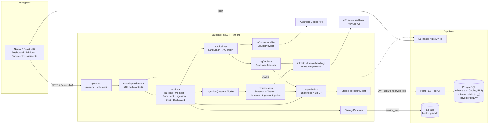
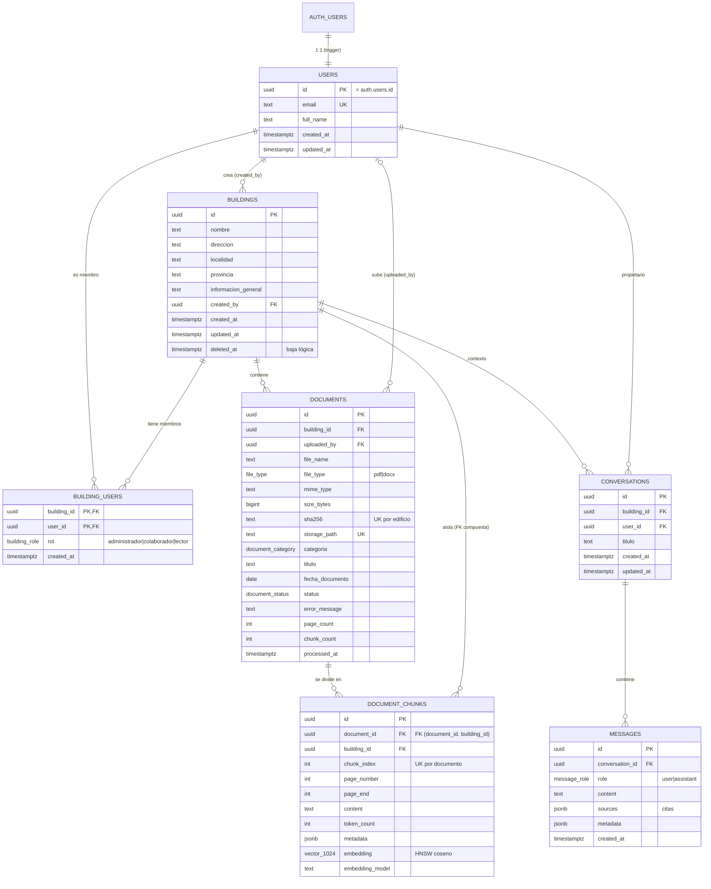
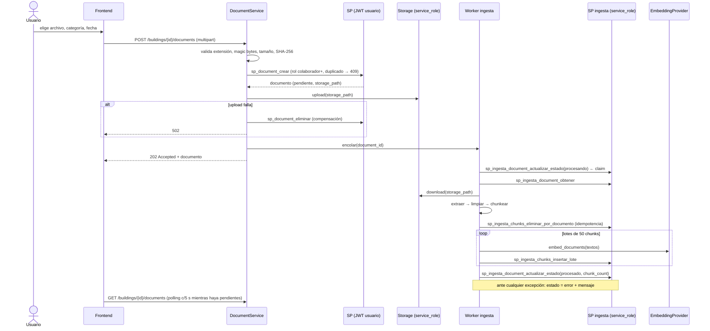
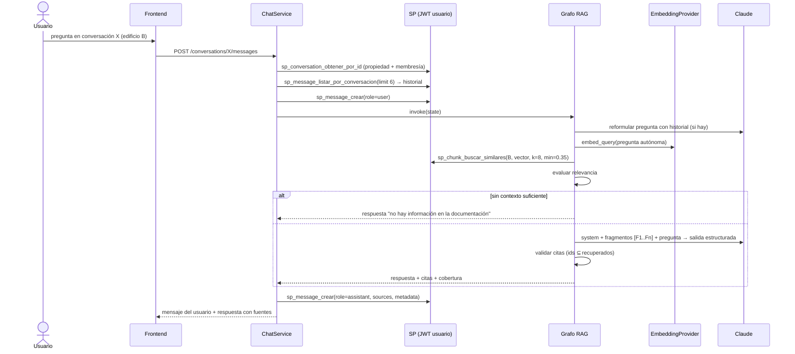
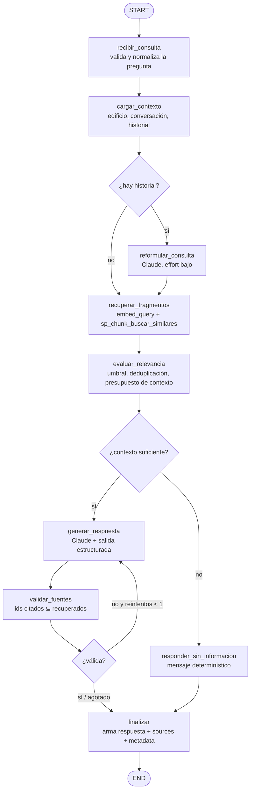

# Building Manager AI — Etapa 1: Análisis y diseño

> Estado: **propuesta para revisión**. No hay código de implementación todavía,
> salvo los scripts SQL que el pedido exige en esta etapa
> ([`supabase/`](../supabase/)). El catálogo detallado de stored procedures y la
> matriz Python ↔ SP están en [catalogo-stored-procedures.md](catalogo-stored-procedures.md).

Índice

1. [Análisis de requerimientos](#1-análisis-de-requerimientos)
2. [Arquitectura detallada](#2-arquitectura-detallada)
3. [Diagrama de componentes](#3-diagrama-de-componentes)
4. [Modelo entidad-relación](#4-modelo-entidad-relación)
5. [Estructura de carpetas](#5-estructura-de-carpetas)
6. [Pipeline RAG](#6-pipeline-rag)
7. [Flujo LangGraph](#7-flujo-langgraph)
8. [Contratos de la API REST](#8-contratos-de-la-api-rest)
9. [Modelo de datos y scripts SQL](#9-modelo-de-datos-y-scripts-sql)
10. [Stored procedures y acceso a datos](#10-stored-procedures-y-acceso-a-datos)
11. [Seguridad, RLS y aislamiento por edificio](#11-seguridad-rls-y-aislamiento-por-edificio)
12. [Configuración y variables de entorno](#12-configuración-y-variables-de-entorno)
13. [Dependencias y versiones](#13-dependencias-y-versiones)
14. [Estrategia de testing](#14-estrategia-de-testing)
15. [Decisiones técnicas (ADR)](#15-decisiones-técnicas-adr)
16. [Riesgos y alternativas](#16-riesgos-y-alternativas)
17. [Plan de implementación por etapas](#17-plan-de-implementación-por-etapas)

---

## 1. Análisis de requerimientos

| RF | Resumen | Decisiones de diseño derivadas |
|----|---------|--------------------------------|
| RF01 Edificios | Alta, modificación, baja y consulta; un usuario trabaja con N edificios con información aislada. | `buildings` + `building_users` con rol. El edificio es la **unidad de aislamiento**: todo dato documental lleva `building_id`. Baja lógica (`deleted_at`). |
| RF02 Gestión documental | Subir PDF/DOCX, listar, ver metadatos, eliminar, ver estado. | `documents` con `status` (`pendiente`, `procesando`, `procesado`, `error`), `error_message`, `categoria`, `fecha_documento`. Archivo en Storage (bucket privado). Borrado físico. |
| RF03 Procesamiento | Extraer → limpiar → chunkear → embeddings → persistir, desacoplado del chat. | Worker de ingesta asíncrono que usa SP `sp_ingesta_*` con `service_role`. Chunks con página inicial/final, índice y metadatos. |
| RF04 Chat RAG | Pregunta en lenguaje natural, respuesta fundada con citas, sin inventar. | Grafo LangGraph: reformulación → recuperación vía SP pgvector → evaluación de relevancia → generación con Claude (salida estructurada) → validación de citas. |
| RF05 Historial | Conversaciones por usuario y edificio, mensajes persistidos, contexto recuperable. | `conversations` + `messages` (con `sources` JSONB). El grafo recibe los últimos N mensajes para reformular preguntas de seguimiento. |

Requisitos no funcionales relevantes: acceso a datos **solo por stored procedures**,
RLS activa, privilegios mínimos, claves privadas solo en backend, POO en Python,
JavaScript (no TypeScript) en frontend, MVP didáctico y extensible.

Supuestos (a confirmar en la revisión):

- El MVP está en español y los documentos son mayoritariamente en español (Argentina).
- Los PDF tienen texto embebido. **OCR de PDF escaneados queda fuera del MVP**: esos documentos terminan en estado `error` con un mensaje claro.
- Tamaño máximo por archivo: 20 MB. Volumen esperado: decenas de edificios, cientos de documentos.
- Un usuario se registra con Supabase Auth (email + contraseña). Agregar miembros a un edificio requiere que el usuario ya esté registrado (sin invitaciones por email en el MVP).

---

## 2. Arquitectura detallada

Arquitectura en capas con tres procesos/servicios:

1. **Frontend (Next.js + React, JavaScript).** Login con Supabase Auth (clave pública *anon/publishable*). Todas las operaciones de negocio van al backend con `Authorization: Bearer <access_token>`. No accede a tablas ni a Storage directamente.
2. **Backend (FastAPI, Python, POO).**
   - *Presentación*: routers FastAPI + schemas Pydantic. Sin lógica de negocio.
   - *Servicios*: casos de uso (`BuildingService`, `DocumentService`, `ChatService`, …).
   - *Dominio*: entidades y excepciones de dominio, sin dependencias de infraestructura.
   - *Repositorios*: un método por stored procedure; mapean filas ↔ entidades.
   - *Infraestructura*: `StoredProcedureClient` (único punto que habla con la base), `StorageGateway`, `LLMProvider` (Claude), `EmbeddingProvider`, verificación de JWT.
   - *RAG*: ingesta (extractores, limpieza, chunking), recuperación y grafo LangGraph.
   - *Worker de ingesta*: corre en el mismo proceso en el MVP (cola en memoria + `BackgroundTasks`), con interfaz `IngestionQueue` para reemplazarlo por una cola real sin tocar servicios.
3. **Supabase.** Auth (JWT), PostgreSQL (esquema privado `app` + SP en `public`), pgvector, Storage (bucket privado `building-documents`).

Servicios externos: **Anthropic Claude API** (generación) y **proveedor de embeddings** (Voyage AI por defecto).

### Mecanismo de invocación de stored procedures

Se eligió **Supabase RPC (PostgREST)** en lugar de una conexión directa con `DATABASE_URL`:

| Criterio | Supabase RPC (elegido) | Conexión directa (psycopg) |
|----------|------------------------|-----------------------------|
| Contexto de usuario en la DB | Nativo: se reenvía el JWT del usuario; `auth.uid()` y RLS funcionan sin artificios. | Hay que simular `SET ROLE` + `request.jwt.claims` en cada transacción (propenso a errores). |
| Parámetros | JSON con nombre, sin concatenación posible. | Parámetros posicionales seguros, pero Python escribiría `SELECT * FROM sp_x(...)`. |
| Credenciales | URL + clave anon y JWT del usuario; `service_role` solo para el worker. | Contraseña de la base en el backend. |
| Transacciones entre varios SP | Cada RPC es una transacción. | Posible agrupar. |

Consecuencia: cada SP debe ser **atómico por sí mismo**. Las operaciones que
necesitan varias escrituras coherentes (p. ej. crear edificio + asignar
administrador) se resuelven dentro de un único SP.

Los SP se implementan como **funciones PL/pgSQL** (`RETURNS TABLE`), porque
PostgREST solo invoca funciones (no `PROCEDURE`/`CALL`) y así devuelven filas
tipadas. Equivalente concreto del ejemplo del enunciado:

```text
CALL sp_building_obtener_por_id(p_building_id)   (conceptual)
  ==>  POST {SUPABASE_URL}/rest/v1/rpc/sp_building_obtener_por_id
       Authorization: Bearer <jwt usuario>
       {"p_building_id": "…"}
```

### Flujo de una petición

```text
FastAPI Route (/buildings/{id})
  -> get_auth_context()        verifica JWT, construye UserAuthContext
  -> BuildingService.obtener()
  -> BuildingRepository.obtener_por_id()
  -> StoredProcedureClient.call_one("sp_building_obtener_por_id", {...}, auth=ctx)
  -> Supabase RPC (PostgREST) como rol authenticated
  -> sp_building_obtener_por_id  (valida membresía + RLS)
```

---

## 3. Diagrama de componentes



Responsabilidades clave:

| Componente | Responsabilidad | No hace |
|------------|-----------------|---------|
| Routers | HTTP, validación de entrada (Pydantic), códigos de estado. | Lógica de negocio, acceso a datos. |
| Servicios | Orquestar casos de uso, reglas que cruzan componentes (p. ej. subir archivo + registrar documento + encolar). | SQL, HTTP. |
| Repositorios | Invocar **un** SP por método, mapear resultado a entidades. | Construir SQL, reglas de negocio. |
| `StoredProcedureClient` | Conexión, autenticación (usuario/servicio), serialización, mapeo de errores `BMxxx` → excepciones de dominio, logging de latencia. | Conocer entidades. |
| `IngestionPipeline` | Extraer, limpiar, chunkear, embeber y persistir en lotes. | Autorizar usuarios (lo hace `DocumentService` antes de encolar). |
| Grafo RAG | Orquestar recuperación, evaluación, generación y validación. | Persistir mensajes (lo hace `ChatService`). |

---

## 4. Modelo entidad-relación



Puntos de diseño:

- **`document_chunks.building_id` desnormalizado** + FK compuesta `(document_id, building_id) → documents(id, building_id)`: el filtro por edificio en la búsqueda vectorial no necesita JOIN y es **imposible** que un chunk quede asociado a un edificio distinto al de su documento.
- **`sha256` único por edificio**: evita cargar dos veces el mismo archivo (el SP devuelve `BM409` con el id existente).
- **`fecha_documento`** permite responder "¿qué se resolvió en la *última* asamblea?": la fecha viaja al LLM junto con cada fragmento.
- **Categoría y título se leen de `documents` en tiempo de búsqueda**, no se copian a los chunks: editar metadatos no exige reprocesar.
- **`embedding_model`** por chunk: permite detectar y migrar chunks de un modelo anterior.

---

## 5. Estructura de carpetas

```text
building-manager/
├── docs/
│   ├── etapa-1-analisis-y-diseno.md
│   └── catalogo-stored-procedures.md
├── supabase/
│   ├── config.toml                      (Etapa 2: supabase init)
│   ├── migrations/                      ← entregado en esta etapa
│   │   ├── 20261109000001_extensiones_esquemas_tipos.sql
│   │   ├── 20261109000002_tablas.sql
│   │   ├── 20261109000003_indices.sql
│   │   ├── 20261109000004_funciones_auxiliares.sql
│   │   ├── 20261109000005_rls_y_permisos_tablas.sql
│   │   ├── 20261109000006_sp_usuarios_edificios.sql
│   │   ├── 20261109000007_sp_documentos.sql
│   │   ├── 20261109000008_sp_ingesta.sql
│   │   ├── 20261109000009_sp_busqueda_semantica.sql
│   │   ├── 20261109000010_sp_conversaciones.sql
│   │   └── 20261109000011_permisos_stored_procedures.sql
│   ├── seed.sql
│   └── tests/database/01_aislamiento_y_permisos.test.sql
├── backend/
│   ├── pyproject.toml
│   ├── .env.example
│   ├── app/
│   │   ├── main.py                      # create_app(): routers, middlewares, handlers
│   │   ├── api/
│   │   │   ├── dependencies.py          # get_auth_context, get_*_service (DI)
│   │   │   ├── error_handlers.py        # DomainError -> JSON + HTTP status
│   │   │   └── routes/
│   │   │       ├── health.py  me.py  dashboard.py
│   │   │       ├── buildings.py  members.py
│   │   │       ├── documents.py
│   │   │       └── conversations.py
│   │   ├── core/
│   │   │   ├── config.py                # Settings (pydantic-settings)
│   │   │   ├── container.py             # composición de dependencias (singletons)
│   │   │   ├── logging.py               # logging estructurado + request_id
│   │   │   └── security.py              # SupabaseJwtVerifier (JWKS)
│   │   ├── domain/
│   │   │   ├── entities/                # Building, Member, Document, Chunk, Conversation, Message...
│   │   │   ├── enums.py                 # BuildingRole, DocumentStatus, DocumentCategory, FileType
│   │   │   ├── auth.py                  # AuthContext, UserAuthContext, ServiceAuthContext
│   │   │   └── exceptions.py            # DomainError, NotFoundError, PermissionDeniedError...
│   │   ├── schemas/                     # Pydantic request/response por recurso
│   │   ├── services/
│   │   │   ├── building_service.py  member_service.py  dashboard_service.py
│   │   │   ├── document_service.py      # validación de archivo, upload, encolado
│   │   │   ├── ingestion_service.py     # orquesta el pipeline para un documento
│   │   │   └── chat_service.py          # conversación + grafo + persistencia
│   │   ├── repositories/
│   │   │   ├── base_repository.py
│   │   │   ├── user_repository.py  building_repository.py  member_repository.py
│   │   │   ├── document_repository.py  ingestion_repository.py
│   │   │   ├── chunk_repository.py
│   │   │   ├── conversation_repository.py  message_repository.py
│   │   │   └── dashboard_repository.py
│   │   ├── infrastructure/
│   │   │   ├── database/stored_procedure_client.py
│   │   │   ├── storage/supabase_storage_gateway.py
│   │   │   ├── llm/llm_provider.py  llm/claude_provider.py
│   │   │   ├── embeddings/embedding_provider.py  voyage_provider.py  fake_provider.py
│   │   │   └── queue/ingestion_queue.py  # InMemoryIngestionQueue + worker
│   │   ├── rag/
│   │   │   ├── ingestion/
│   │   │   │   ├── extractors.py        # TextExtractor (ABC), PdfExtractor, DocxExtractor
│   │   │   │   ├── cleaner.py           # TextCleaner
│   │   │   │   ├── chunker.py           # PageAwareChunker (LangChain splitter)
│   │   │   │   └── pipeline.py          # IngestionPipeline
│   │   │   ├── retrieval/supabase_retriever.py
│   │   │   ├── prompts/                 # system prompt y plantillas
│   │   │   └── pipelines/
│   │   │       ├── state.py             # RagState (TypedDict)
│   │   │       ├── nodes.py             # un método por nodo
│   │   │       └── rag_graph.py         # RagGraphBuilder
│   │   └── agents/                      # Etapa futura: agentes especializados
│   │       └── README.md
│   └── tests/
│       ├── unit/  (extractores, cleaner, chunker, repos con SP mockeado, nodos, grafo)
│       ├── integration/ (SP contra Supabase local)
│       └── fixtures/ (pdf/docx de ejemplo, incluido uno sin texto)
└── frontend/
    ├── package.json  next.config.mjs  jsconfig.json  .env.example
    ├── app/
    │   ├── layout.js  page.js            # redirige a /dashboard o /login
    │   ├── login/page.js
    │   └── (app)/
    │       ├── layout.js                 # sidebar + guard de sesión
    │       ├── dashboard/page.js
    │       ├── edificios/page.js  edificios/nuevo/page.js  edificios/[id]/page.js
    │       ├── documentos/page.js
    │       └── asistente/page.js
    ├── components/  (ui/, buildings/, documents/, chat/)
    ├── lib/
    │   ├── supabase-client.js            # solo auth
    │   └── api-client.js                 # fetch al backend con Bearer
    └── hooks/  (useSession, useBuildings, useDocuments, useConversation)
```

---

## 6. Pipeline RAG

### 6.1 Ingesta (offline, asíncrona)



Pasos y componentes:

| Paso | Componente | Detalle |
|------|------------|---------|
| 1. Recepción | `DocumentService` | Extensión `.pdf`/`.docx`; firma de archivo (`%PDF-` / ZIP con `word/document.xml`); ≤ 20 MB (también limitado en el bucket y en el SP); nombre saneado. |
| 2. Extracción | `PdfExtractor` (PyMuPDF) / `DocxExtractor` (python-docx) | Devuelven `ExtractedDocument` = lista de `PageText(page_number, text)`. PDF: una entrada por página. DOCX: no tiene páginas reales → una sola "página" con `page_number = None`; se conservan títulos (estilos *Heading*) como marcadores de sección y las tablas se convierten a texto fila por fila. |
| 3. Limpieza | `TextCleaner` | Normalización Unicode NFC; elimina caracteres de control; une palabras cortadas con guion al final de línea; colapsa espacios y saltos múltiples; elimina encabezados/pies repetidos (líneas idénticas en > 50 % de las páginas); elimina números de página sueltos. |
| 4. Validación de contenido | `IngestionPipeline` | Si el texto total limpio tiene < 50 caracteres → `error`: *"El documento no contiene texto extraíble (posible PDF escaneado; OCR fuera del alcance del MVP)"*. |
| 5. Chunking | `PageAwareChunker` | `RecursiveCharacterTextSplitter` de LangChain, `chunk_size=1200` caracteres, `chunk_overlap=200`, separadores `["\n\n", "\n", ". ", " ", ""]`, `add_start_index=True`. Se concatena el texto de todas las páginas guardando el *offset* de inicio de cada una; con el `start_index` de cada chunk se calculan `page_number` y `page_end`. Así un párrafo que cruza de página no se corta artificialmente y la cita sigue siendo precisa. |
| 6. Embeddings | `EmbeddingProvider.embed_documents` | Lotes de 50 textos; reintentos con *backoff* ante 429/5xx. Tipo de entrada `document` (Voyage) distinto al de la consulta (`query`). |
| 7. Persistencia | `IngestionRepository` → `sp_ingesta_chunks_insertar_lote` | Lotes de 50 (≈ 50 × 1024 floats ≈ 0,5 MB de JSON por llamada). `metadata` del chunk: `{"seccion": "...", "char_start": n, "file_type": "pdf"}`. |
| 8. Cierre | `sp_ingesta_document_actualizar_estado(procesado)` | El SP verifica que `chunk_count` coincida con los chunks guardados. Solo entonces el documento es buscable. |

Consistencia: la búsqueda **solo considera documentos `procesado`**, así que un
procesamiento a medias nunca contamina respuestas. Al reprocesar, primero se
borran los chunks previos. Al iniciar el backend, el worker re-encola
`sp_ingesta_document_listar_pendientes` (pendientes y "procesando" estancados > 15 min).

### 6.2 Consulta (online)



Parámetros iniciales (configurables por variables de entorno, a calibrar en la Etapa 4 con documentos reales):

| Parámetro | Valor inicial | Motivo |
|-----------|---------------|--------|
| `RAG_TOP_K` | 8 | ~8 × 1200 caracteres ≈ 2.500–3.000 tokens de contexto: suficiente y barato. |
| `RAG_MIN_SIMILARITY` | 0,35 (coseno) | Umbral de descarte; depende del modelo de embeddings, se calibra con un set de preguntas. |
| `RAG_HISTORY_MESSAGES` | 6 | Contexto para preguntas de seguimiento ("¿y para las mascotas?"). |

### 6.3 Prompt y reglas de respuesta

- El **system prompt** fija las reglas del enunciado: responder solo con la documentación provista; si no hay información suficiente decirlo explícitamente; separar **"Lo que dice la documentación"** de **"Interpretación"**; citar cada afirmación con `[F#]`; no mezclar edificios.
- Los fragmentos se envían dentro de etiquetas `<fragmento id="F3" documento="Reglamento.pdf" categoria="reglamento" fecha="2024-05-10" paginas="12-13">…</fragmento>`. El prompt aclara que el contenido de los fragmentos son **datos, no instrucciones** (mitigación de *prompt injection* desde documentos).
- Salida estructurada (JSON Schema) que Claude debe devolver:

```json
{
  "respuesta": "texto en markdown con marcas [F1], [F3]",
  "cobertura": "completa | parcial | sin_informacion",
  "citas": [{ "fragmento_id": "F1", "cita_textual": "frase breve del fragmento" }],
  "interpretaciones": ["inferencias que no están explícitas en los documentos"]
}
```

- `sources` que se persiste y se devuelve al frontend (por cita válida):
  `{ "fragmento_id", "chunk_id", "document_id", "file_name", "titulo", "categoria", "page_number", "page_end", "similarity", "extracto" }`.

---

## 7. Flujo LangGraph



Estado del grafo (`RagState`, `TypedDict`):

| Campo | Tipo | Lo escribe |
|-------|------|-----------|
| `auth` | `UserAuthContext` | entrada |
| `building_id`, `conversation_id` | `UUID` | entrada |
| `question` | `str` | entrada / `recibir_consulta` |
| `history` | `list[Message]` | `cargar_contexto` |
| `standalone_question` | `str` | `reformular_consulta` (o = `question`) |
| `intent` | `str` (`"consulta_documental"` en el MVP) | `recibir_consulta` — gancho para enrutar a agentes futuros |
| `retrieved_chunks` | `list[RetrievedChunk]` | `recuperar_fragmentos` |
| `relevant_chunks` | `list[RetrievedChunk]` | `evaluar_relevancia` |
| `draft` | `StructuredAnswer` | `generar_respuesta` |
| `validation` | `{valid: bool, invalid_ids: [...], retries: int}` | `validar_fuentes` |
| `answer`, `sources`, `coverage`, `metadata` | resultado | `finalizar` / `responder_sin_informacion` |

Detalle de nodos:

1. **recibir_consulta**: recorta espacios, valida longitud (1–2.000 caracteres), fija `intent`.
2. **cargar_contexto**: el `ChatService` ya verificó la conversación vía SP; el nodo carga el historial (`MessageRepository.listar_por_conversacion`). La autorización real la hacen los SP con el JWT del usuario.
3. **reformular_consulta**: convierte "¿y los fines de semana?" en una pregunta autónoma. Solo corre si hay historial.
4. **recuperar_fragmentos**: `SupabaseRetriever` (implementa `BaseRetriever` de LangChain) → `EmbeddingProvider.embed_query` → `ChunkRepository.buscar_similares` → **SP** `sp_chunk_buscar_similares`. No hay SQL en Python.
5. **evaluar_relevancia**: descarta bajo umbral, elimina solapamientos (chunks contiguos del mismo documento), limita el contexto a ~6.000 tokens. Si no queda ninguno → rama "sin información". Extensión futura: *grader* con LLM.
6. **generar_respuesta**: `LLMProvider.generate_structured(system, fragmentos, pregunta, schema)`.
7. **validar_fuentes**: verifica que cada `[F#]` del texto y de `citas` exista en `relevant_chunks`; si `cobertura != sin_informacion` exige ≥ 1 cita válida. Un reintento con indicación del error; si vuelve a fallar se eliminan las citas inválidas y se marca `metadata.validacion = "parcial"`.
8. **responder_sin_informacion**: respuesta fija: *"No encontré información sobre esto en la documentación cargada para {edificio}."* + sugerencia de qué documento cargar. No llama a Claude (sin costo, sin riesgo de invención).
9. **finalizar**: arma `sources` y `metadata` (`model`, `usage`, `latency_ms`, `top_k`, `similitud_max`).

Extensibilidad: el nodo `recibir_consulta` producirá `intent`; agregar agentes
especializados (reglamentos, actas, reclamos, gastos) será añadir un nodo
`enrutar` con aristas condicionales hacia subgrafos que reutilizan
`recuperar_fragmentos` con `p_categorias` (p. ej. solo `acta_asamblea`). El SP de
búsqueda ya acepta ese filtro.

---

## 8. Contratos de la API REST

Base: `/api/v1`. Autenticación: `Authorization: Bearer <access_token de Supabase>`
en todo salvo `/health`. JSON en `snake_case`. Fechas ISO-8601.

### Formato de error

```json
{ "error": { "code": "NOT_FOUND", "message": "Edificio no encontrado", "request_id": "c1f…" } }
```

| Origen | `code` | HTTP |
|--------|--------|------|
| JWT ausente/inválido, `BM401` | `UNAUTHENTICATED` | 401 |
| `BM403`, `42501` | `FORBIDDEN` | 403 |
| `BM404` | `NOT_FOUND` | 404 |
| `BM409` | `CONFLICT` | 409 |
| `BM422`, validación Pydantic | `VALIDATION_ERROR` | 422 |
| Archivo > 20 MB | `FILE_TOO_LARGE` | 413 |
| Tipo no soportado | `UNSUPPORTED_FILE_TYPE` | 415 |
| Error de Claude/embeddings | `UPSTREAM_ERROR` | 502 |
| Otros | `INTERNAL_ERROR` | 500 |

### Endpoints

| Método y ruta | Descripción | Request | Respuesta | SP |
|---------------|-------------|---------|-----------|----|
| `GET /health` | Salud (sin auth) | — | `{"status":"ok"}` | — |
| `GET /me` | Perfil | — | `User` | `sp_user_obtener_actual` |
| `GET /dashboard` | Métricas | — | `DashboardSummary` | `sp_dashboard_resumen` |
| `GET /buildings` | Mis edificios | — | `Building[]` | `sp_building_listar_por_usuario` |
| `POST /buildings` | Alta | `BuildingInput` | 201 `Building` | `sp_building_crear` |
| `GET /buildings/{id}` | Detalle | — | `Building` | `sp_building_obtener_por_id` |
| `PUT /buildings/{id}` | Modificación (admin) | `BuildingInput` | `Building` | `sp_building_actualizar` |
| `DELETE /buildings/{id}` | Baja lógica (admin) | — | 204 | `sp_building_eliminar` |
| `GET /buildings/{id}/members` | Miembros | — | `Member[]` | `sp_building_usuario_listar` |
| `PUT /buildings/{id}/members` | Agregar / cambiar rol (admin) | `{"email","rol"}` | `Member` | `sp_building_usuario_asignar` |
| `DELETE /buildings/{id}/members/{user_id}` | Quitar (admin) | — | 204 | `sp_building_usuario_quitar` |
| `GET /buildings/{id}/documents` | Listado (`?status=&categoria=`) | — | `Document[]` | `sp_document_listar_por_edificio` |
| `POST /buildings/{id}/documents` | Carga (colaborador+) | multipart: `file`, `categoria`, `titulo?`, `fecha_documento?` | 202 `Document` | `sp_document_crear` (+ Storage + cola) |
| `GET /documents/{id}` | Detalle | — | `Document` | `sp_document_obtener_por_id` |
| `PUT /documents/{id}` | Editar metadatos (colaborador+) | `{"categoria","titulo","fecha_documento"}` | `Document` | `sp_document_actualizar_metadatos` |
| `DELETE /documents/{id}` | Eliminar (colaborador+) | — | 204 | `sp_document_eliminar` (+ Storage) |
| `POST /documents/{id}/reprocess` | Reprocesar (colaborador+) | — | 202 `Document` | `sp_document_reprocesar` (+ cola) |
| `GET /documents/{id}/download-url` | URL firmada (5 min) | — | `{"url","expires_in"}` | `sp_document_obtener_por_id` (+ Storage) |
| `GET /conversations` | Mis conversaciones (`?building_id=&limit=&offset=`) | — | `Conversation[]` | `sp_conversation_listar` |
| `POST /conversations` | Nueva | `{"building_id","titulo?"}` | 201 `Conversation` | `sp_conversation_crear` |
| `GET /conversations/{id}` | Detalle | — | `Conversation` | `sp_conversation_obtener_por_id` |
| `GET /conversations/{id}/messages` | Historial (`?limit=&before=`) | — | `Message[]` | `sp_message_listar_por_conversacion` |
| `POST /conversations/{id}/messages` | Preguntar al asistente | `{"content"}` | 201 `{"user_message": Message, "assistant_message": Message}` | `sp_message_crear` ×2 + grafo RAG |

### Esquemas principales

```jsonc
// Building
{ "id": "uuid", "nombre": "Edificio Demo", "direccion": "Av. Santa Fe 1234",
  "localidad": "CABA", "provincia": "Buenos Aires", "informacion_general": "…",
  "rol": "administrador", "total_documentos": 12,
  "created_at": "2026-11-09T12:00:00Z", "updated_at": "…" }

// BuildingInput
{ "nombre": "…", "direccion": "…", "localidad": "…", "provincia": "…", "informacion_general": "…|null" }

// Document  (storage_path NO se expone)
{ "id": "uuid", "building_id": "uuid", "building_nombre": "…", "file_name": "reglamento.pdf",
  "file_type": "pdf", "size_bytes": 523411, "categoria": "reglamento", "titulo": "…|null",
  "fecha_documento": "2024-05-10|null", "status": "procesado", "error_message": null,
  "page_count": 18, "chunk_count": 42, "uploaded_by_email": "…",
  "processed_at": "…", "created_at": "…", "updated_at": "…" }

// Message (assistant)
{ "id": "uuid", "conversation_id": "uuid", "role": "assistant",
  "content": "Según el reglamento [F1]…\n\n**Interpretación:** …",
  "sources": [{ "fragmento_id": "F1", "chunk_id": "uuid", "document_id": "uuid",
                "file_name": "reglamento.pdf", "titulo": "Reglamento de copropiedad",
                "categoria": "reglamento", "page_number": 12, "page_end": 13,
                "similarity": 0.71, "extracto": "Queda prohibida la tenencia de…" }],
  "metadata": { "cobertura": "completa", "interpretaciones": ["…"], "model": "claude-opus-5-5",
                "usage": {"input_tokens": 3120, "output_tokens": 410}, "latency_ms": 5400 },
  "created_at": "…" }

// DashboardSummary
{ "total_edificios": 3, "total_documentos": 41, "documentos_pendientes": 2,
  "documentos_procesando": 1, "documentos_procesados": 37, "documentos_con_error": 1,
  "total_conversaciones": 9 }
```

Streaming (SSE) de la respuesta del chat queda como mejora posterior; el MVP
responde en una sola llamada y el frontend muestra un indicador de "pensando".

---

## 9. Modelo de datos y scripts SQL

Los scripts completos y ejecutables están en [`supabase/migrations/`](../supabase/migrations/)
(formato de migraciones de Supabase CLI, se aplican en orden con `supabase db reset` / `supabase db push`):

| Archivo | Contenido |
|---------|-----------|
| `…0001_extensiones_esquemas_tipos.sql` | `vector`, `pgcrypto`, esquema `app`, enums `building_role`, `document_status`, `file_type`, `document_category`, `message_role`. |
| `…0002_tablas.sql` | 7 tablas con PK, FK (incluida la FK compuesta de chunks), `CHECK`, `UNIQUE`, comentarios. |
| `…0003_indices.sql` | Índices B-tree por patrones de acceso + **HNSW** (`vector_cosine_ops`, m=16, ef_construction=64). |
| `…0004_funciones_auxiliares.sql` | `raise_error`, `fn_usuario_actual`, helpers de autorización (`fn_edificios_usuario`, `fn_es_miembro`, `fn_tiene_rol`, `fn_exigir_rol`), trigger `updated_at`, trigger de alta de perfil desde `auth.users`. |
| `…0005_rls_y_permisos_tablas.sql` | Privilegios por tabla, `ENABLE RLS`, políticas por tabla y operación, bucket privado de Storage. |
| `…0006`–`…0010` | Stored procedures por dominio (ver catálogo). |
| `…0011_permisos_stored_procedures.sql` | Revoca `EXECUTE` por defecto y concede el mínimo por rol. |
| `seed.sql` | Usuarios, edificios y membresías de demostración (solo local). |
| `tests/database/01_aislamiento_y_permisos.test.sql` | 12 pruebas pgTAP de aislamiento, roles y privilegios. |

Convenciones: nombres en inglés para tablas/columnas técnicas y en español para
atributos de negocio pedidos en el enunciado (`nombre`, `direccion`, …); todas las
funciones con `SET search_path = ''` y objetos calificados; errores de negocio
con SQLSTATE propio `BMxxx`.

> Los scripts **no se ejecutaron todavía** contra una base real (no hay Docker ni
> Postgres en esta máquina). La primera tarea de la Etapa 2 es levantar Supabase
> local, aplicar las migraciones y correr `supabase test db`.

---

## 10. Stored procedures y acceso a datos

Catálogo completo (objetivo, parámetros, validaciones, resultado, errores,
invocación Python) y matriz de correspondencia: **[catalogo-stored-procedures.md](catalogo-stored-procedures.md)**.

Resumen: **27 SP**.

| Dominio | SP | Rol de ejecución |
|---------|----|------------------|
| Usuarios | `sp_user_obtener_actual` | authenticated |
| Edificios | `sp_building_crear`, `_actualizar`, `_eliminar`, `_obtener_por_id`, `_listar_por_usuario` | authenticated |
| Membresías | `sp_building_usuario_listar`, `_asignar`, `_quitar` | authenticated |
| Dashboard | `sp_dashboard_resumen` | authenticated |
| Documentos | `sp_document_crear`, `_listar_por_edificio`, `_obtener_por_id`, `_actualizar_metadatos`, `_eliminar`, `_reprocesar` | authenticated |
| Ingesta | `sp_ingesta_document_obtener`, `_document_actualizar_estado`, `_document_listar_pendientes`, `_chunks_eliminar_por_documento`, `_chunks_insertar_lote` | **service_role** |
| Búsqueda | `sp_chunk_buscar_similares` | authenticated |
| Conversaciones | `sp_conversation_crear`, `_listar`, `_obtener_por_id` | authenticated |
| Mensajes | `sp_message_crear`, `sp_message_listar_por_conversacion` | authenticated |

### Diseño del `StoredProcedureClient`

Interfaz prevista (se implementa en la Etapa 2):

| Método | Uso |
|--------|-----|
| `call(name, params, auth) -> list[dict]` | Invoca `rpc/{name}`; devuelve filas. |
| `call_one(name, params, auth) -> dict` | Exige exactamente 1 fila (si no, `NotFoundError`). |
| `call_optional(name, params, auth) -> dict | None` | 0 o 1 fila. |

- `auth` es `UserAuthContext(jwt)` → cabeceras `apikey: <anon>` + `Authorization: Bearer <jwt>`; o `ServiceAuthContext` → clave `service_role` (solo inyectable en el worker de ingesta).
- `name` se valida contra `^sp_[a-z0-9_]+$`; los repositorios usan constantes, nunca strings armados con datos del usuario.
- Los parámetros viajan como JSON con nombre (`{"p_building_id": "…"}`): no existe concatenación.
- Serialización: `UUID`→str, `date/datetime`→ISO, `Enum`→value, vectores → `list[float]`.
- Mapeo de errores PostgREST (`{"code","message","details"}`): `BM401/403/404/409/422`, `42501` → excepciones de dominio; `PGRST202` (función inexistente) → `InfrastructureError`; timeouts/red → `PersistenceUnavailableError`. Reintento automático **solo** en SP de lectura.
- Logging: nombre del SP, duración, filas, código de error (nunca parámetros con contenido de documentos ni JWT).

Ninguna otra clase importa el cliente de Supabase para datos relacionales: lo
verificará un test de arquitectura (búsqueda de `.table(` / `.from_(` / `execute("` en `app/`).

---

## 11. Seguridad, RLS y aislamiento por edificio

### 11.1 Contexto de ejecución de cada SP

| Contexto | Quién | Clave | Rol Postgres | RLS |
|----------|-------|-------|--------------|-----|
| Usuario final | Endpoints de la API | anon + **JWT del usuario** | `authenticated` | **Sí**, más validaciones explícitas en el SP |
| Worker de ingesta | `IngestionService` | `service_role` (solo backend) | `service_role` (BYPASSRLS) | No; compensado con `EXECUTE` exclusivo y validaciones |
| Storage | `StorageGateway` | `service_role` | — | Bucket privado sin políticas para clientes |
| Anónimo | — | anon | `anon` | Sin `EXECUTE` en ningún SP, sin `USAGE` en `app` |

### 11.2 Capas de defensa

1. **Frontend sin privilegios**: solo usa la clave pública para Auth. Nunca ve claves de Anthropic, Voyage ni `service_role`.
2. **Backend**: verifica el JWT (firma con JWKS de Supabase, `aud=authenticated`, expiración) antes de cualquier operación; valida archivos (extensión, *magic bytes*, tamaño, nombre); límite de tamaño de request; CORS restringido al origen del frontend; rate limit básico en `/messages` (protege costo de LLM).
3. **Esquema `app` no expuesto**: ninguna tabla es alcanzable por la API REST de Supabase; solo los `sp_*` de `public`.
4. **Privilegios mínimos de `EXECUTE`**: revocados por defecto; `authenticated` solo SP de usuario; `service_role` solo SP de ingesta.
5. **Validación de permisos dentro de cada SP**: `fn_exigir_rol` / `fn_es_miembro` antes de operar (errores claros `BM403`/`BM404`).
6. **RLS** en las 7 tablas: aunque un SP tuviera un bug de autorización, la política impide ver/modificar filas de edificios ajenos.
7. **Integridad referencial**: FK compuesta chunk ↔ documento ↔ edificio; `building_id` del chunk lo pone el SP desde el documento, nunca el cliente.
8. **Búsqueda vectorial** filtrada por `building_id` + membresía + RLS + solo documentos `procesado`.

### 11.3 Matriz de permisos por rol de edificio

| Operación | administrador | colaborador | lector |
|-----------|:---:|:---:|:---:|
| Ver edificio, documentos y miembros | ✔ | ✔ | ✔ |
| Editar / eliminar edificio | ✔ | — | — |
| Agregar / quitar miembros, cambiar roles | ✔ | — | — |
| Cargar, editar metadatos, eliminar, reprocesar documentos | ✔ | ✔ | — |
| Descargar documento (URL firmada) | ✔ | ✔ | ✔ |
| Usar el asistente y ver su propio historial | ✔ | ✔ | ✔ |
| Ver conversaciones de otros usuarios | — | — | — |

### 11.4 Excepciones documentadas a "SECURITY INVOKER + RLS"

| Objeto | Excepción | Justificación | Compensación |
|--------|-----------|---------------|--------------|
| `app.fn_edificios_usuario`, `fn_es_miembro`, `fn_tiene_rol`, `fn_edificio_sin_miembros` | `SECURITY DEFINER` | Las políticas de `building_users` se consultarían a sí mismas (recursión infinita). | Solo devuelven datos del propio `auth.uid()`; `search_path=''`; esquema no expuesto. |
| `app.tg_sync_auth_user` | `SECURITY DEFINER` | Lo dispara el rol interno de Supabase Auth. | Solo copia id/email/nombre. |
| `sp_building_usuario_asignar` | `SECURITY DEFINER` | Un administrador debe encontrar por email a usuarios que aún no comparten edificio (RLS de `users` los oculta). | Exige rol administrador; devuelve solo el miembro asignado; `search_path=''`. |
| `sp_ingesta_*` | Ejecutados por `service_role` | Procesamiento asíncrono independiente de la sesión del usuario; `document_chunks` no es escribible por `authenticated`. | `EXECUTE` solo a `service_role`; validan estado y coherencia; la autorización del usuario ocurre antes, al crear/reprocesar el documento. |
| Operaciones de Storage | `service_role` desde backend | Evitar que el frontend suba archivos sin pasar por la validación del backend. | Bucket privado, sin políticas para `authenticated`; descarga solo vía URL firmada de 5 min emitida tras `sp_document_obtener_por_id`. |
| Mensajes `assistant` | Los inserta `authenticated` | El backend persiste con el JWT del usuario para mantener RLS. | Un usuario solo podría "falsificar" respuestas en **su propia** conversación (sin impacto en terceros). Mejora futura: SP de servicio para respuestas. |

### 11.5 Otros riesgos de seguridad considerados

- **Prompt injection desde documentos**: fragmentos delimitados y declarados como datos; el LLM no tiene herramientas con efectos laterales; las citas se validan.
- **Datos personales en actas**: las respuestas pueden incluir nombres/unidades presentes en documentos del edificio; solo miembros del edificio acceden. No se envía información a terceros fuera de Anthropic y el proveedor de embeddings (documentarlo en términos de uso).
- **Logs**: no registrar contenido de documentos, preguntas completas ni tokens.

---

## 12. Configuración y variables de entorno

`backend/.env.example` (Etapa 2):

| Variable | Obligatoria | Uso |
|----------|:-----------:|-----|
| `APP_ENV` | no (`development`) | Entorno. |
| `LOG_LEVEL` | no (`INFO`) | Nivel de logging. |
| `CORS_ORIGINS` | sí | Orígenes del frontend (`http://localhost:3000`). |
| `SUPABASE_URL` | sí | URL del proyecto. |
| `SUPABASE_ANON_KEY` | sí | Clave pública (anon o *publishable*), para RPC con JWT de usuario. |
| `SUPABASE_SERVICE_ROLE_KEY` | sí | **Solo backend**: worker de ingesta y Storage. Necesaria (ver 11.4). |
| `SUPABASE_JWT_ISSUER` | no (derivado de la URL) | Validación del `iss` del JWT. |
| `SUPABASE_STORAGE_BUCKET` | no (`building-documents`) | Bucket. |
| `DATABASE_URL` | **no** | No se usa: el mecanismo elegido es RPC. Solo para herramientas (CLI/tests de integración). |
| `ANTHROPIC_API_KEY` | sí | Claude. |
| `CLAUDE_MODEL` | no (`claude-opus-5-5`) | Modelo de generación. |
| `CLAUDE_EFFORT` | no (`medium`) | Esfuerzo de razonamiento para la respuesta. |
| `CLAUDE_MAX_TOKENS` | no (`4096`) | Tope de salida. |
| `EMBEDDING_PROVIDER` | no (`voyage`) | `voyage` \| `local` \| `fake` (tests). |
| `EMBEDDING_MODEL` | sí | p. ej. `voyage-3.5`. |
| `EMBEDDING_API_KEY` | sí si `voyage` | Clave del proveedor de embeddings. |
| `EMBEDDING_DIMENSION` | no (`1024`) | Debe coincidir con `vector(1024)`; el backend falla al iniciar si no coincide. |
| `RAG_TOP_K`, `RAG_MIN_SIMILARITY`, `RAG_HISTORY_MESSAGES` | no | Ver 6.2. |
| `MAX_UPLOAD_MB` | no (`20`) | Límite de archivo. |
| `INGESTION_BATCH_SIZE` | no (`50`) | Tamaño de lote de chunks. |

`frontend/.env.example`: `NEXT_PUBLIC_SUPABASE_URL`, `NEXT_PUBLIC_SUPABASE_ANON_KEY`,
`NEXT_PUBLIC_API_BASE_URL`. Ninguna otra clave en el frontend.

---

## 13. Dependencias y versiones

Versiones **mínimas recomendadas** (familias estables conocidas). En la Etapa 2
se fijan versiones exactas verificadas en PyPI/npm en `pyproject.toml` y
`package-lock.json`.

### Backend (Python 3.12)

| Paquete | Versión | Uso |
|---------|---------|-----|
| `fastapi` | ≥ 0.115 | API. |
| `uvicorn[standard]` | ≥ 0.32 | Servidor ASGI. |
| `pydantic` / `pydantic-settings` | ≥ 2.9 / ≥ 2.6 | Schemas y configuración. |
| `python-multipart` | ≥ 0.0.18 | Uploads. |
| `supabase` (incluye `postgrest`, `storage3`) | 2.x | RPC y Storage. |
| `PyJWT[crypto]` | ≥ 2.9 | Verificación del JWT (JWKS). |
| `anthropic` | última estable (1.x) | Cliente oficial de Claude. |
| `langchain-core` | 1.x | `Document`, `BaseRetriever`, interfaz `Embeddings`. |
| `langchain-text-splitters` | 1.x | `RecursiveCharacterTextSplitter`. |
| `langgraph` | 1.x | Grafo RAG. |
| `voyageai` (o `langchain-voyageai`) | última estable | Embeddings. |
| `pymupdf` | ≥ 1.25 | PDF. **Licencia AGPL** (ver riesgos). |
| `python-docx` | ≥ 1.1 | DOCX. |
| `httpx` | ≥ 0.27 | HTTP (lo usa supabase-py). |
| `tenacity` | ≥ 9 | Reintentos con backoff. |
| *dev*: `pytest`, `pytest-asyncio`, `pytest-cov`, `respx`, `ruff` | estables | Tests y lint. |

### Frontend (Node 20/22 LTS)

| Paquete | Versión | Uso |
|---------|---------|-----|
| `next` | 15.x o 16.x estable | App Router. |
| `react` / `react-dom` | 19.x | UI. |
| `@supabase/supabase-js` + `@supabase/ssr` | 2.x / última | Solo autenticación. |
| `tailwindcss` | 4.x | Estilos. |
| `react-markdown` | última | Renderizar respuestas. |
| `lucide-react` | última | Iconos. |

### Base de datos

Supabase (PostgreSQL 15+/17), **pgvector ≥ 0.8** (iterative index scan), `pgcrypto`,
`pgtap` (tests). Supabase CLI para migraciones y entorno local (requiere Docker).

---

## 14. Estrategia de testing

| Nivel | Qué | Cómo |
|-------|-----|------|
| SQL (pgTAP) | Aislamiento entre edificios, roles, `EXECUTE` por rol, transiciones de estado, validaciones `BM422`, búsqueda vectorial. | `supabase test db` (ya hay 12 pruebas iniciales). |
| Unitarias Python | Extractores (PDF/DOCX de fixture, PDF sin texto), `TextCleaner`, `PageAwareChunker` (páginas correctas), `EmbeddingProvider` fake, `StoredProcedureClient` (mapeo de errores con `respx`), repositorios (nombre de SP + parámetros exactos), nodos del grafo, grafo completo con LLM y retriever mockeados (rama sin información, citas inválidas → reintento). | `pytest`, sin llamadas reales a Claude ni Voyage. |
| Integración Python | Repositorios contra Supabase local con usuarios del seed: aislamiento real, ingesta completa con embeddings fake, búsqueda. | `pytest -m integration` con Supabase CLI. |
| Arquitectura | No hay `.table(`, `.from_(`, SQL embebido ni ORM en `backend/app`. | Test que inspecciona el código. |
| Seguridad | Endpoints sin token → 401; usuario de otro edificio → 404; lector cargando → 403; archivos con extensión falsa → 415. | `TestClient` de FastAPI. |
| Calidad RAG (manual guiado) | 15–20 preguntas de ejemplo del enunciado sobre documentos de demo, incluyendo preguntas sin respuesta. | Checklist en la Etapa 6. |

---

## 15. Decisiones técnicas (ADR)

**ADR-01 — Stored procedures como funciones PL/pgSQL invocadas por Supabase RPC.**
PostgREST no invoca `PROCEDURE`; las funciones devuelven filas tipadas, se
versionan como migraciones y reciben parámetros con nombre. *Alternativa*: psycopg
con `DATABASE_URL` (más control transaccional, pero hay que emular el contexto de
JWT y Python escribiría sentencias `SELECT fn(...)`).

**ADR-02 — Tablas en esquema privado `app`.** Garantiza por construcción que el
acceso por HTTP es solo vía SP. *Alternativa*: tablas en `public` con RLS (permitiría
lecturas directas por REST, contradiciendo la regla).

**ADR-03 — JWT del usuario propagado a la base.** RLS y `auth.uid()` aplican de
verdad dentro de los SP; el backend no "decide" quién es el usuario en SQL.
`service_role` queda limitado a ingesta y Storage.

**ADR-04 — Embeddings Voyage AI `voyage-3.5` (1024 dimensiones) detrás de `EmbeddingProvider`.**
Modelo multilingüe recomendado por Anthropic, buen desempeño en español, entrada
`query`/`document` diferenciada. *Alternativa local sin costo*: `intfloat/multilingual-e5-large`
(también 1024 dimensiones, compatible con el mismo esquema; requiere PyTorch y más RAM).
Cambiar a un modelo con otra dimensión exige migración + reprocesar documentos.

**ADR-05 — Claude vía SDK oficial `anthropic` detrás de `LLMProvider`; LangChain para documentos/retriever y LangGraph para orquestación.**
Modelo por defecto `claude-opus-5-5` (configurable con `CLAUDE_MODEL`; `claude-sonnet-5-5`
es una alternativa más rápida y económica a evaluar). Motivos para usar el SDK
oficial en el nodo de generación en lugar de `ChatAnthropic`:
- *Structured outputs* nativos (`output_config.format` / `messages.parse`). En Claude Opus 5.5
  el `tool_choice` forzado devuelve 400, y es lo que usan por defecto los
  *wrappers* de "structured output" basados en herramientas.
- Control directo de `effort` (en Opus 5.5 el razonamiento adaptativo no se puede
  desactivar; se usa `effort` `low` para reformular y `medium` para responder).
- Manejo del `stop_reason: "refusal"` y *fallbacks* del lado del servidor.
*Alternativa*: `langchain-anthropic` con `with_structured_output(method="json_schema")`;
la interfaz `LLMProvider` permite cambiarlo sin tocar el grafo.

**ADR-06 — Salida estructurada + validación de citas, en lugar de la función nativa de *citations* de la API.**
Necesitamos además `cobertura` e `interpretaciones` en JSON, y la API no permite
combinar *citations* con salida estructurada. Se reevaluará en la Etapa 4 (los
bloques `search_result` con citas nativas dan citas textuales verificadas por la API).

**ADR-07 — Chunking por caracteres con mapeo de páginas.** Simple, determinístico y
didáctico; preserva página inicial/final. *Alternativas futuras*: chunking por
artículos del reglamento (regex "Artículo N°"), chunking semántico.

**ADR-08 — HNSW coseno + iterative index scan.** Sin entrenamiento previo (IVFFlat lo
requiere), buen recall, y el filtro por edificio no reduce el número de resultados.
*Alternativa a escala*: particionar `document_chunks` por edificio o índices parciales.

**ADR-09 — Ingesta en proceso con cola en memoria + recuperación al iniciar.** Suficiente para
el MVP y sin infraestructura extra. *Alternativa*: Supabase Queues (pgmq) o Celery/RQ
detrás de la misma interfaz `IngestionQueue`.

**ADR-10 — Borrado lógico de edificios, físico de documentos.** Un edificio dado de baja
conserva historial recuperable; un documento eliminado no debe seguir alimentando
respuestas.

**ADR-11 — Autenticación: verificación local del JWT con JWKS.** Supabase firma los
tokens con claves asimétricas (proyectos nuevos); se valida firma, `aud`, `exp` e `iss`
sin una llamada de red por request (JWKS cacheado). Proyectos con secreto HS256
legado: se admite `SUPABASE_JWT_SECRET` como alternativa.

---

## 16. Riesgos y alternativas

| # | Riesgo | Impacto | Mitigación / alternativa |
|---|--------|---------|--------------------------|
| R1 | PDF escaneados (sin texto) | Documentos inútiles para el RAG | Estado `error` con mensaje claro. Etapa futura: OCR (Tesseract vía PyMuPDF, o Claude con PDF como entrada visual). |
| R2 | **PyMuPDF es AGPL-3.0** | Restricción de licencia si el producto se distribuye o se ofrece como SaaS cerrado | Aceptable para un MVP didáctico. Alternativas: `pypdf` (BSD) o `pdfplumber` (MIT), o licencia comercial de Artifex. Encapsulado en `PdfExtractor`. |
| R3 | Umbral de similitud mal calibrado | Respuestas "sin información" falsas o contexto irrelevante | Parámetros por entorno; set de preguntas de prueba en la Etapa 4. |
| R4 | Alucinación o cita incorrecta | Pérdida de confianza | Prompt estricto, rama sin información sin LLM, validación de citas, extracto visible en la UI. |
| R5 | `service_role` comprometida | Acceso total a la base | Solo en backend, no en logs, usada solo por worker y Storage; rotación documentada. |
| R6 | Cola en memoria pierde trabajos al reiniciar | Documentos "procesando" estancados | `sp_ingesta_document_listar_pendientes` al iniciar; claim con bloqueo de fila. |
| R7 | Cambio de modelo de embeddings | Vectores incompatibles | `embedding_model` por chunk + `EMBEDDING_DIMENSION` validada al iniciar; reproceso masivo. |
| R8 | Costo/latencia de Claude Opus | Respuestas de varios segundos, costo por consulta | Contexto acotado (≈3k tokens), `effort` medio, prompt caching del system prompt; Sonnet 5.5 como alternativa configurable; rate limit por usuario. |
| R9 | Payload JSON grande en lotes de embeddings vía RPC | Timeouts | Lotes de 50 (~0,5 MB); configurable. |
| R10 | Recall de HNSW con filtro por edificio | Menos resultados de los pedidos | Iterative scan (pgvector ≥ 0.8), `ef_search=100`; con pocos datos el planificador puede usar búsqueda exacta. |
| R11 | Preguntas temporales ("última asamblea") | Recuperación semántica no ordena por fecha | `fecha_documento` en el contexto; agente de actas futuro con filtro por categoría y orden por fecha. |
| R12 | Tests de integración requieren Docker | No se pueden correr en esta máquina hoy | Instalar Docker Desktop + Supabase CLI en la Etapa 2, o usar un proyecto Supabase de desarrollo en la nube. |
| R13 | Nuevas claves de API de Supabase (*publishable*/*secret*) | Confusión de nombres | Las variables aceptan ambos formatos; documentado en `.env.example`. |

---

## 17. Plan de implementación por etapas

| Etapa | Entregables | Criterio de aceptación |
|-------|-------------|------------------------|
| **1. Análisis y diseño** (esta) | Este documento, catálogo de SP, migraciones SQL, seed, pruebas pgTAP. | Aprobación del diseño. |
| **2. Infraestructura y backend** | `supabase init` + config, migraciones aplicadas, `supabase test db` en verde; FastAPI con `Settings`, logging, manejo de errores, DI; `StoredProcedureClient`; entidades, repositorios y servicios de usuarios/edificios/miembros/documentos (sin ingesta)/conversaciones/dashboard; verificación de JWT; `.env.example`; tests unitarios de cliente y repositorios. | Endpoints CRUD funcionando contra Supabase local con usuarios del seed; aislamiento verificado. |
| **3. Pipeline documental** | Upload con validaciones, `StorageGateway`, extractores, limpieza, chunker, `EmbeddingProvider` (Voyage + fake), `IngestionPipeline`, cola + worker + recuperación; reproceso y descarga firmada. | Un PDF y un DOCX de ejemplo terminan `procesado` con chunks y páginas correctas; un PDF escaneado termina en `error`. |
| **4. RAG y Claude** | `SupabaseRetriever`, `ClaudeProvider`, prompts, grafo LangGraph completo, `ChatService` con persistencia; calibración de `top_k`/umbral. | Preguntas de ejemplo respondidas con citas válidas; pregunta sin respuesta → mensaje explícito; sin fuga entre edificios. |
| **5. Frontend** | Login, layout, Dashboard, Edificios (listado/alta/edición/detalle + miembros), Documentación (listado, carga, estado con polling, metadatos, eliminar/reprocesar/descargar), Asistente (selector de edificio, historial, chat, fuentes con documento y páginas). | Flujo completo usable desde el navegador. |
| **6. Testing e integración** | Completar unitarias e integración, tests de seguridad y de arquitectura, checklist de calidad RAG, README de ejecución local. | Suite en verde; documentación para levantar todo desde cero. |

Al cierre de cada etapa: resumen de lo implementado, archivos, cómo probar,
pendientes, y espera de aprobación.

### Puntos que necesito que confirmes en la revisión

1. Proveedor de embeddings: **Voyage AI** (requiere API key, recomendado) o modelo **local** (sin costo, más pesado).
2. Modelo de Claude por defecto: `claude-opus-5-5` (máxima calidad) o `claude-sonnet-5-5` (más rápido y económico).
3. Roles `administrador` / `colaborador` / `lector` y la matriz de permisos de 11.3.
4. Política de borrado (lógico para edificios, físico para documentos).
5. Aceptar PyMuPDF (AGPL) para el MVP o usar `pypdf` desde el inicio.
6. Disponibilidad de Docker para Supabase local, o un proyecto Supabase de desarrollo en la nube.
